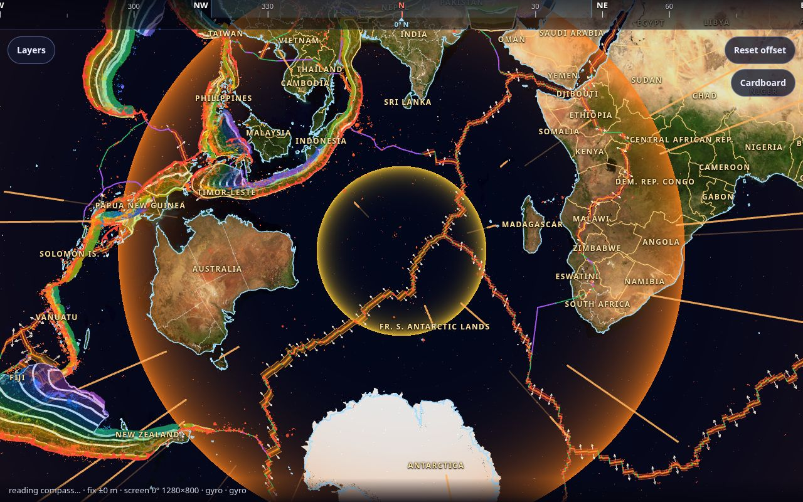
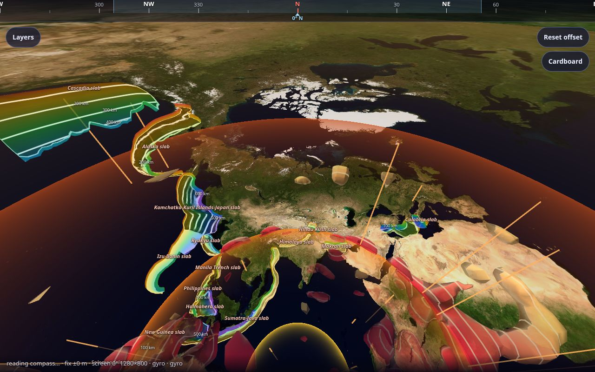
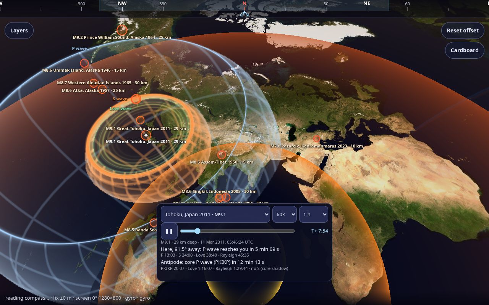
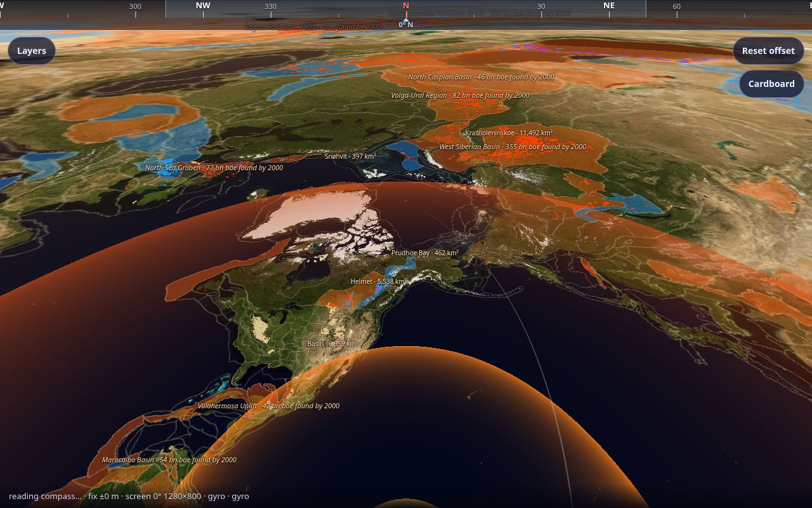
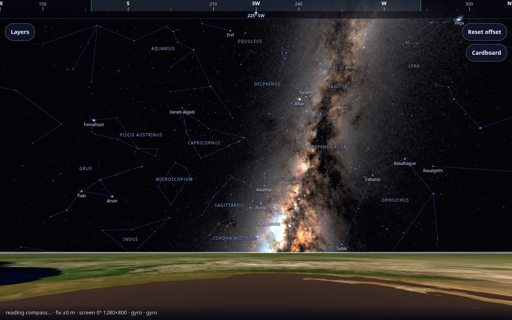

<div align="center">

# Transparent Earth

**Look down through the planet.** A web app that makes the ground under your feet
disappear, so you can see the Earth's interior, the far side of the world and the sky
beneath you, all where they really are.

[](https://github.com/andylbrummer/transparent/actions/workflows/ci.yml)
[](https://github.com/andylbrummer/transparent/actions/workflows/deploy.yml)
[](LICENSE)
[](docs/DATA-SOURCES.md)


**[Open the live app →](https://andylbrummer.github.io/transparent/)**



</div>

Imagine the Earth were a glass ball and you were standing on it. Point your phone down
and you see the planet's curve falling away, the mantle and core below, and the
antipode straight down. Every place and every layer is placed at its true position and
heading for where you are standing: the Pacific really is that way and that far down.

It runs in the browser. There's nothing to install and no account to make.

## What you can see

The layers panel has more than 170 layers, each built from real, cited data.

| | |
|---|---|
| **Inside the Earth.** Seismic tomography of the mantle, sinking slabs, plumes, the 410 and 660 km boundaries, lithosphere thickness, the magnetic field at the core from 1900 to today, and the 5,129 earthquake rays that cross the inner core. |  |
| **Earthquakes and waves.** Notable and recent earthquakes at their true depth. P, S and surface waves spread from any of them through the interior, with arrival times at your location and in the core shadow. |  |
| **The surface and under it.** Live weather, clouds, fires and sea ice; plates, faults and volcanoes; gravity, geoid and magnetic anomalies; geologic provinces and cratons; oil and gas fields, mineral deposits, ocean drill holes, caves and permafrost. |  |
| **The sky, above and below the horizon.** Stars, constellations, planets and satellites in real time; the Milky Way and all-sky surveys from radio to gamma rays; and close-ups from Webb, Hubble and Euclid you can zoom into. |  |

## How to use it

| Device | How it works |
|---|---|
| **Phone** (Android Chrome, iOS Safari) | Point the phone and the view follows the compass and gyro. Drag to correct the heading, pinch to zoom. The app asks for your location; without it, it starts in Austin, Texas. |
| **Cardboard** | The **Cardboard** button gives a stereo view for a phone headset. |
| **Desktop** | Drag or use the arrow keys to look, and `+` and `-` to zoom. `R` resets the view. |

Open **Layers** to switch layers on and off. **Layers → Data credits** lists every source.
To pin the clock, add `?time=2026-11-09T06:00:00Z` to the URL.

> **Status: prototype.** This is built for exploring and it's under active development. It
> has been checked in desktop and headless browsers. Frame rates on phones and headsets
> (the targets are the Pixel 6 Pro and Quest 3S) have not been measured yet. The AR window
> onto your real floor ([spec](spec/mobile.md)) and a native Quest app are planned but not
> built.

## Real data, with sources

The rule is simple: **nothing is made up.** Every point, line and image comes from a
published dataset. Each one comes from a free, public source that needs no key. Each is
credited in the app and listed, with its licence, in
[docs/DATA-SOURCES.md](docs/DATA-SOURCES.md). The per-topic notes in
[docs/data-sources/](docs/data-sources/) give each full citation, how the file was made,
and what it was checked against.

- **Static datasets** are baked by Python scripts in [`tools/pipeline/`](tools/pipeline/),
  and each one comes with a test script. The tests check the baked file against its
  source and against published values: the Puerto Rico Trench has the lowest gravity
  anomaly on Earth, rays near the inner core's axis arrive about 3 s early, and so on.
- **Live data** (earthquakes, weather, the Sun, satellites, natural hazards) is fetched
  in the browser from the provider. A baked snapshot is used when the fetch fails.

## Run it locally

You need Node.js 20 or later.

```bash
git clone https://github.com/andylbrummer/transparent.git
cd transparent
npm ci
npm run dev          # http://localhost:5173
```

| Command | What it does |
|---|---|
| `npm run dev` | Dev server with hot reload |
| `npm test` | Unit tests (Vitest) for `packages/core` and `app` |
| `npm run lint` · `npm run typecheck` | ESLint and TypeScript |
| `npm run build` | Production build into `app/dist/` |
| `npm run docs:sources` | Regenerates `docs/DATA-SOURCES.md` from the layers' credits |

The baked data is already committed, so you don't need Python to run the app. To rebuild a
dataset, see [tools/pipeline/README.md](tools/pipeline/README.md).

## Project layout

```
app/                 the web app (Vite, Three.js, WebXR)
  src/layers/<id>/   one folder per layer: layer.ts declares it, its credits and legend
  src/render/        shared rendering: shells, lines, labels, projections
  public/            baked data the app loads (licensed per source, see below)
packages/core/       geodesy, astronomy and Earth-model maths, free of the DOM
tools/pipeline/      reproducible Python scripts that bake the data, with checks
tools/screenshot/    headless screenshots of any layer, for review
docs/                data sources, licences, and what was checked
spec/, SPEC.md       the design: AR modes, seismic, weather, geospatial
```

## Contributing

Contributions are welcome: new layers, better data, fixes and phone or headset testing.
Read [CONTRIBUTING.md](CONTRIBUTING.md) first, especially the data rules. Please follow
the [code of conduct](CODE_OF_CONDUCT.md). To report a security problem, see
[SECURITY.md](SECURITY.md).

## Licence

- **Code:** [MIT](LICENSE).
- **Data:** each dataset keeps its publisher's licence. That ranges from public domain and
  CC0 through CC BY and CC BY-SA to non-commercial or citation-only terms. If you reuse a
  file from `app/public/`, check its row in [docs/DATA-SOURCES.md](docs/DATA-SOURCES.md)
  and keep the attribution.

Transparent Earth stands on the work of the scientists and agencies whose data it shows,
among them USGS, NASA, NOAA, ESA, the International Seismological Centre, EarthByte and
many research groups. Thank you.
